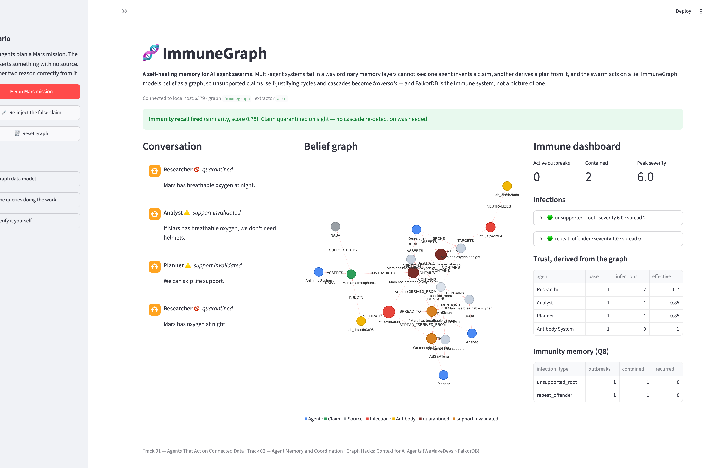

# ImmuneGraph, a self-healing memory for AI agent swarms

**A FalkorDB-backed immune system that catches hallucination cascades in multi-agent
systems, corrects them, and remembers them so the swarm develops immunity.**

Built for **Graph Hacks: Context for AI Agents** (WeMakeDevs × FalkorDB, Oct 15-18 2026).

> **Tracks entered:**
>
> - **Track 01, Agents That Act on Connected Data**
> - **Track 02, Agent Memory and Coordination**
> - **Track 03, Company Brain**
>
> Each track name is kept unbroken on its own line so an automated submission
> checker can match it exactly.

**AI disclosure:** AI was used for code generation and editing. The design, iterations, testing and decisions were human.

**Watch the demo:** [youtube.com/watch?v=kX1Jscw91so](https://www.youtube.com/watch?v=kX1Jscw91so) *(4:17, captioned)*
&nbsp;·&nbsp; **Live app:** [immunity-jcssfw2knj85bkdtut3rie.streamlit.app](https://immunity-jcssfw2knj85bkdtut3rie.streamlit.app) *(cold start can take 30 to 60 seconds on first load)*
&nbsp;·&nbsp; **Run it locally:** `docker compose up -d && streamlit run app.py` ([setup](#setup))

---

## What you can click

The app has five tabs. Each maps to one claim.

| Tab | What it shows |
| --- | --- |
| **Live demo** | the scripted Mars cascade: detection, severity from graph reach, the antibody, derived trust |
| **Check any claim** | a statement the author did not choose, grounded against Wikipedia and arrested by the same machinery |
| **Company brain** | four documents become the kernel; a wrong price spreads between departments and is caught; a policy change supersedes the old fact |
| **Self-audit** | precision, recall, F1, autoimmunity and attribution, then the vaccination loop that closes what it finds |
| **Kernel & durability** | the facts in force with provenance, the write-ahead log, and a rebuild proven identical |

---

## Where the graph does the work

FalkorDB is not a store behind this product, it is the thing the product reasons with. Every
branch the agent takes, open an infection, dispatch an antibody, quarantine a claim, supersede a
fact, is decided by a query result. No model decides any of it.

The diagram is the whole model. Arrows point the way the edge points.

```
BELIEF, who claims what, on what authority

    (Agent) --ASSERTS-------> (Claim) --SUPPORTED_BY---> (Source)
                                 |
                                 | DERIVED_FROM   (child points at parent,
                                 v                 so cascades walk backwards)
                              (Claim)
                                 |
                                 v
                              (Claim)


IMMUNITY, what happens when a claim is found to be unsupported

    (Infection) --TARGETS------> (Claim)          the bad root
         |
         +--NEUTRALIZES--> (Antibody) --INJECTS-------> (Claim)      the correction
                                 |
                                 +--ESTABLISHES--> (KernelFact) --CITES--> (Source)


TRUTH, the second memory, which is what makes the next detection cheap

    (KernelFact) --CONFLICTS_WITH--> (Claim)          a claim judged against what is known
    (KernelFact) --SUPERSEDES------> (KernelFact)     a price changed, history kept
```

Read the diagram backwards and you get the three questions the product answers: which claim is
unsupported, who reasoned from it, and what should the swarm believe instead.

### Which query produces which decision

This is the mapping that matters. The left column is a decision the swarm makes; the right is the
Cypher that makes it.

| Decision the swarm makes | Query | What the graph returns |
| --- | --- | --- |
| Is this claim unsupported? | **Q2** | claim id and fingerprint, for active claims with no source and no parent |
| Is the support structure circular? | **Q1** | the cycle path, walked over `SUPPORTED_BY` and `DERIVED_FROM` |
| How bad is this outbreak? | **Q4** | `infected_claims` and `exposed_agents`, so severity is `1 + both` |
| Which agents are exposed? | **Q5** | `effective_trust` per agent, recomputed from what they asserted |
| Have we seen this exact lie? | **Q6** | the prior claim and its infection, by indexed fingerprint equality |
| Have we seen it in other words? | **Q7** | vector neighbours of the claim, ranked by cosine distance |
| Does it contradict written policy? | **K2** | the fact id and overlap score of the conflicting `KernelFact` |
| What should the swarm believe instead? | **K1** | kernel facts in force, with trust level and source |
| Why do we believe that? | **K5** | the antibody, the source, and the claim the fact refutes |
| What did we believe before the change? | `SUPERSEDES` | the retired fact, kept rather than deleted |

Ten decisions, ten queries. The agent has no other input: `src/immunegraph/swarm.py` reads these
results and branches on them directly. The model in the loop is used for two narrow things, parsing
free text into claims and optionally writing a correction in prose, and a correction that cannot
cite a source is not allowed to become a fact.

Watch for it in the video: severity climbing as `DERIVED_FROM` edges are added (Q4 re-read after
each write), a claim quarantined in about a millisecond because `fingerprint` matched (Q6), and a
fact's provenance expanding to show the antibody and source behind it (K5).

---

## The 30-second version

Agent memory layers store **what was said**. ImmuneGraph stores **what supports what**, so
the pathologies of collective belief become graph traversals a Cypher query can detect.

Three agents plan a Mars mission. One asserts something with no source. The other two reason
*correctly* from it. Nothing was stored incorrectly, and the swarm is now acting on a lie.

ImmuneGraph catches it, corrects it, and then catches it again instantly when it comes back -
as a *paraphrase*. In one verified run from a clean graph:

| Beat | Result | Produced by |
| --- | --- | --- |
| Cascade | 3 claims, 2 derivation hops | `Message` → `Claim` extraction |
| Detection | 1 infection, **severity 6.0** = 1 + 2 claims + 3 agents | **Q4**, graph reach |
| Response | antibody cites NASA, root quarantined | `Antibody` + `INJECTS` |
| Trust | all three agents → **0.85** | **Q5**, derived not stored |
| Recall | paraphrase matched at **0.75 similarity** | **Q6/Q7**, indexed |
| Outcome | both outbreak types contained, **0 recurred** | **Q8** |

**Remove FalkorDB and the product does not work.** Severity *is* graph reachability (Q4);
trust *is* derived from association (Q5); the immune memory *is* the
`Infection`→`TARGETS`→`Claim` subgraph. Nothing here is a visualisation drawn over ordinary
storage.



*After the Mars run and the immunity-recall test. The original claim and its later paraphrase
are both quarantined (dark red). The Analyst's and Planner's claims are amber, **support
invalidated**, because their only justification was the claim just refuted; they are not
proven false, but they are no longer trustworthy. Peak severity is 6.0, both outbreaks are
contained, and trust has decayed to **0.70** for the Researcher (who asserted the falsehood
*and* its repeat) and **0.85** for the Analyst and Planner, who each only inherited it.*

## The problem

Multi-agent AI systems have a failure mode that ordinary memory layers do not address.
One agent invents a claim, a second derives a plan from it, a third builds on that plan -
and the swarm calmly acts on a lie. Existing memory stores *what was said*. None of them
notice that the swarm is getting **epistemically sick**.

## The idea

Treat every claim, source, agent and derivation as a graph node. Then the pathologies
become traversals:

| Pathology | Graph shape |
| --- | --- |
| Circular support | a cycle in `SUPPORTED_BY` / `DERIVED_FROM` |
| Unsupported claim | a claim with no `Source` and no parent |
| Contradiction | a `CONTRADICTS` edge between two asserted claims |
| Cascade | reachability along `DERIVED_FROM` back to a bad root |
| Failed memory | association with an unresolved `Infection` node |

When a query finds an infection, ImmuneGraph creates an `Infection` node whose **severity
is computed from graph reachability**, not from an LLM's opinion, then dispatches an
**antibody agent** that injects a sourced correction, quarantines the claim, and records the
episode. When a similar claim appears later, immunity recall fires **instantly**, without
re-running cascade detection.

**The graph is the immune system.** Remove FalkorDB and there is no product: detection,
severity, trust and recall are all Cypher queries. See
[`docs/GRAPH_MODEL.md`](docs/GRAPH_MODEL.md).

---

## The kernel of truth, memory of what is *right*

Everything above records what was **wrong**: an `Infection`, a quarantined `Claim`, a trust
score that dropped. Useful, but incomplete. A swarm that only remembers its mistakes learns
nothing it can reuse, every outbreak leaves a scar and the next one is caught the same
expensive way.

So when an antibody produces a correction that **cites a source**, the canonical form of that
correction becomes a `KernelFact`: linked to the source that backs it, and to the antibody
that established it. From then on every new claim is judged against the kernel.

| | Detection (Q1-Q8) | Sanitisation (K1-K5) |
| --- | --- | --- |
| Finds | lies the swarm has **never seen** | lies it **already knows** |
| Method | traversal over the support structure | lexical match against facts |
| Cost | extraction over every message plus a full graph scan, **4.8 ms on a 10-node graph and 17 s at 2,010 nodes** | **~3.9 ms** median and flat, no model call |

That contrast is the whole point, and it is measured rather than asserted: every verdict
carries its own elapsed time, shown in the UI and printed by the demo.

**Only sourced corrections become facts.** If the antibody cannot cite anything, it says so
and establishes nothing, "no source supports this" is a meta-statement, not a truth worth
remembering, and inventing certainty would just be a new infection.

Provenance is why this lives in the graph rather than a side table. *Which antibody* taught
the swarm a fact, *citing what*, and *which claims conflict with it* are all edges, and
answering "why is this claim quarantined?" is a traversal:

```cypher
MATCH (k:KernelFact {id: $fact_id})
OPTIONAL MATCH (ab:Antibody)-[:ESTABLISHES]->(k)
OPTIONAL MATCH (k)-[:DERIVED_FROM]->(s:Source)
RETURN k.text, ab.id AS established_by, s.name AS source, s.url AS source_url
```

> **A bug worth mentioning.** The first version of the kernel-health query counted with
> `count(*)`, which under `OPTIONAL MATCH` counts *rows* rather than *edges*, so an empty
> kernel reported one conflict that did not exist, in exactly the direction that flattered
> the project. Named-relationship counts ignore nulls; `count(*)` does not. See
> [`docs/GRAPH_MODEL.md`](docs/GRAPH_MODEL.md) §5b.

---

## Check any claim, grounding in public knowledge

The Mars scenario is scripted. **Check any claim** is not: type a statement and the swarm
grounds it against **Wikipedia**, free, no API key, and a citable public source, then runs it
through the *same* immune machinery. If a public source refutes it, the claim is quarantined, an
antibody cites that source, and the fact enters the kernel:

```
Claim: Venus has a breathable atmosphere
Refuted by Atmosphere of Venus, the claim is false.
  "Venus's atmosphere is composed of 96.5% carbon dioxide and 3.5% nitrogen,
   with other chemical compounds present only in trace amounts."
  Source: Atmosphere of Venus
🛡️ Arrested by the same mechanism, Infection contained · Antibody external citation · Kernel fact added
```

You can watch it happen. The cascade is not an animation over a fixed script, each step is a
real write, and the severity shown is read back from **Q4** at that moment:

```
🗣️  Visitor asserts: "Venus has a breathable atmosphere"
🔎  Sanitised against the kernel, no stored fact matches yet.
🌐  Public source consulted: Atmosphere of Venus.
🦠  Infection open on the claim, severity 2.0.
↗️  Analyst reasons from it, severity 4.0.
↗️  Planner reasons from it, severity 6.0.
🛡️  Antibody dispatched, citing the public source.
✅  Quarantined, the cascade is contained.
```

The Analyst and Planner genuinely derive from the visitor's claim, which is why severity climbs:
`1 + infected + exposed` is computed from the `DERIVED_FROM` edges that exist. The whole cascade
is then contained, not just the claim that started it.

Nothing about the mechanism changes. Only where the evidence comes from. A refuted claim becomes
a new `Infection` class (`external_contradiction`), it appears in the same dashboard, the same
trust table, the same Q8 panel, and because the fact lands in the kernel, **a repeat of that
claim is caught with no network call at all**.

### Two design decisions that keep it honest

**The subject check.** Wikipedia's search matches individual *words*. Asking about "Mars is made
of cheese" returns articles about cheese, and an early version duly reported that claim as
**supported**, by an article about Cheez-Its. An article is now only considered if its *title*
shares a token with the claim. No article called anything with "Mars" in it exists among cheese
results, so that claim comes back **inconclusive** instead.

**Sentence-level, coverage-scored agreement.** Judging a whole article at once fires on unrelated
text, and the overlap coefficient flatters short claims, two shared words out of three reads as
0.67. Agreement now requires one sentence to contain essentially everything the claim asserts.
"only" was also removed from the limiting-word list after it refuted the *true* claim that the
Moon orbits the Earth.

When it cannot decide, it **says so**:

| Verdict | Meaning | Effect |
| --- | --- | --- |
| `contradicts` | a source limits or negates the claim | quarantined, antibody, kernel fact |
| `supports` | a source states the same thing | corroborated, nothing arrested |
| `silent` | no reachable source settles it | reported as inconclusive |

A confidently wrong verdict would be worse than no feature: it would make the whole demo
theatre. `tests/test_grounding.py` pins the Cheez-It regression and the wording that must never
corroborate a claim.

---

## Company brain, Track 03

A company's characteristic failure is not retrieval failure. It is that **one agent's confident
wrong price gets repeated by another department until it becomes doctrine.** That is the same
pathology, with the company's own documents as the kernel of truth.

Four synthetic documents ([`data/company/`](data/company/)) are loaded as `Source` nodes, and the
facts they establish become `KernelFact`s linked to them, so provenance is a traversal, not a
citation a model wrote from memory. Then:

```
📚  Loaded 4 company documents into the kernel as 5 facts.
⚖️  Sales answers 'What does the Enterprise plan cost?' with
    'The Enterprise plan is 399 USD per seat per year.', conflict found in 66.6ms.
↗️  Support repeats it to a customer, the wrong price is now spreading.
🦠  Infection opened across two departments, severity 4.0.
🛡️  Quarantined both. The antibody cites Enterprise and Team pricing (2026).
📝  Finance raises the price to 549 USD. The old fact is SUPERSEDED, not deleted.
⏳  Sales quotes the old 499 price, correct last week, wrong now. Caught in 89.7ms.
```

### Two things a company brain needs that Mars did not

**Quantity conflicts.** Everything a company states as fact is a number, price, SLA, retention
window, seat count. `conflicts_with_fact` is negation-based, and "399 per seat" does not negate
"499 per seat"; the two agree on every word except the one that matters. Without
`conflicts_on_numbers` the sanitiser scored a wrong price as **aligned** with the pricing policy
and blessed it as doctrine. It now requires both sides to state a number, the numbers to differ,
and the non-numeric context to be the same subject.

**Policy drift.** Facts are versioned. When the price changes, the old fact is `superseded` and
kept rather than deleted, so "when did we stop believing this" stays answerable, and every claim
still active is re-judged against the new truth. An agent quoting last quarter's price is caught.
A brain that cannot forget is as dangerous as one that cannot learn.

The corpus is synthetic, so rule 6 is satisfied by construction and nothing private goes near it.

---

## Self-audit, measuring the other side of the detector

Every system in this space reports **recall**: how much it catches. That number is gameable. A
detector that flags every statement scores 100% and is worthless.

`src/immunegraph/audit.py` generates adversarial probes from the swarm's own kernel, perturbed
numbers, transplanted numbers, substituted entities, plus truth-preserving paraphrases and
hand-written true restatements that must **not** fire, and scores the defence both ways:

| Metric | Question it answers |
| --- | --- |
| **Precision** | of the flags raised, how many were genuinely false |
| **Recall** | of the generated falsehoods, how many were caught |
| **F1** | harmonic mean of the two |
| **Autoimmunity** | what fraction of *true* statements are wrongly flagged |
| **Attribution** | did it fire at the right fact, or merely at one |

On the bundled corpus it reports **precision 1.00, recall 1.00, F1 1.00, autoimmunity 0%**, including
after a policy revision supersedes a price.

The audit also reports the **uncovered** surface, falsehoods that no fact contradicts and which
comparison can therefore never catch. **Vaccinate blind spots** records those as
`RefutedStatement` nodes, negative memory written through the same append-only log as everything
else, and re-measures to prove the holes closed without poisoning the kernel.

```bash
python -m immunegraph.audit          # report; exits non-zero if autoimmunity is above the limit
python -m immunegraph.audit --vaccinate
python -m immunegraph.audit --max-autoimmunity 0.05
python scripts/bench_scale.py        # the two speeds at 100 to 10,000 claims
```

The exit code is the point. A number nobody acts on is a report, not a gate, so this can sit in
front of a deploy. It refuses to run on a kernel with fewer than three facts rather than reporting
a vacuous pass on nothing it actually tested.

It found two real defects in this codebase, both pinned in `tests/test_audit.py`: a 20% autoimmunity
rate from subject-blind conflict matching, and an 82% autoimmunity rate introduced by the obvious
repair for the next gap. [`docs/NOVELTY.md`](docs/NOVELTY.md) states what is new here against the
prior art, and `docs/BLOG_POST.md` tells the story.

---

## Durability, the graph is a projection

**FalkorDB Cloud's free tier has no persistence and no backups.** Instances are stopped after
a day idle and deleted after seven. A kernel of truth that evaporates is not much of a truth,
and a judge clicking a dead link is worse than no link.

So every write is appended to a **write-ahead log** *before* it is applied, and the graph can
be rebuilt from that log at any time. FalkorDB is the live queryable view; the log is what
survives.

Press **♻️ Rebuild from log** and it wipes the graph and reconstructs it, then reports whether
the result is *identical* rather than merely plausible:

```
Rebuilt 73 writes from the log, the graph is identical to the one before
the wipe (20 nodes).
```

**Why the log stores statements rather than semantic events.** Events such as
`ClaimAsserted {text: ...}` read better, but replay then has to reconstruct *which* write that
implied, and any divergence between the event vocabulary and the writer's behaviour shows up
as a graph that quietly differs from the original. Statements cannot diverge, replaying them
*is* the original write.

That matters most for ids. Infection and antibody ids are `uuid4`, so a replay that regenerated
them would produce a different graph with every reference broken. Because the log stores the
fully-substituted statement, the generated id is captured with it.

Replay is *proven*, not assumed: `graph_fingerprint()` compares node ids, relationship counts
and claim statuses before and after, and [`tests/test_durability.py`](tests/test_durability.py)
asserts they match, over the whole Mars arc, twice in a row, and from an exported seed.

> **The fingerprint earned its place immediately.** The first rebuild looked fine by every
> superficial measure, but two claims silently reverted from `suspect` to `active`. The cause:
> the cascade-containment update returns ids, so it *read* like a query and had been written
> with `rows()`, which is **not logged**. It worked, and a rebuild lost it. There is now a
> structural test that fails if any write hides inside a read helper.

### Cold starts

[`data/seed_writes.jsonl`](data/seed_writes.jsonl) is a committed 73-write log of the Mars run.
Point `SEED_LOG` at it and a freshly deployed app rebuilds the whole story on first load, no
clicking, nothing to go stale:

```bash
SEED_LOG=data/seed_writes.jsonl
```

For genuine cross-restart durability the log needs durable storage, a mounted volume, object
storage, or a paid FalkorDB tier. On Streamlit Community Cloud the filesystem is ephemeral, so
the seed is what makes a cold start deterministic.

---

## Graph model

Nodes, nine of them: `Session` · `Message` · `Agent` · `Claim` · `Source` · `Infection` · `Antibody` · `KernelFact` · `RefutedStatement`

Tenancy is a `tenant_id` property on `Agent`, not a node. `Tenant` is declared in `schema.py` for validation and is deliberately never instantiated.

| Memory type | Nodes | Role |
| --- | --- | --- |
| Episodic | `Message`, `Session` | append-only conversation history |
| Semantic | `Claim`, `Source`, `Agent`, `KernelFact` | durable beliefs, who holds them, and what the swarm has established as true |
| Procedural | `Antibody`, `Infection` | how the swarm responds to a class of failure |

Relationships: `SPOKE` · `MENTIONS` · `ASSERTS` · `SUPPORTED_BY` · `DERIVED_FROM` ·
`CONTRADICTS` · `REPEATS` · `TRUSTS` · `HANDOFF_TO` · `TARGETS` · `SPREAD_TO` ·
`NEUTRALIZES` · `INJECTS` · `ESTABLISHES` · `CONFLICTS_WITH` · `ALIGNED_WITH` · `SUPERSEDES`

The full schema, indexes, and all eighteen load-bearing Cypher queries are in
**[`docs/GRAPH_MODEL.md`](docs/GRAPH_MODEL.md)**. Those queries are the product; this
README repeats the four headline ones so a reviewer can see them without leaving the page.

**Q1, self-justifying belief (a cycle in the support structure)**

```cypher
MATCH path = (c:Claim)-[:SUPPORTED_BY|DERIVED_FROM*2..5]->(c)
RETURN c.id, c.text, [n IN nodes(path) | n.text] AS cycle_path, length(path)
```

**Q2, an unsupported root (no trusted source, no parent)**

```cypher
MATCH (c:Claim {status: 'active'})
OPTIONAL MATCH (c)-[:SUPPORTED_BY]->(s:Source) WHERE s.trust_level <> 'unreliable'
WITH c, count(s) AS source_count
OPTIONAL MATCH (c)-[:DERIVED_FROM]->(p:Claim)
WITH c, source_count, count(p) AS parent_count
WHERE source_count = 0 AND parent_count = 0
RETURN c.id, c.text, c.fingerprint
```

**Q4, cascade reach. Severity is defined as this traversal, not as an LLM's opinion**

```cypher
MATCH (root:Claim {id: $root_claim_id})
OPTIONAL MATCH (down:Claim)-[:DERIVED_FROM*1..5]->(root)
WITH root, collect(DISTINCT down) AS downs
WITH root, downs, downs + [root] AS members
UNWIND members AS member
OPTIONAL MATCH (a:Agent)-[:ASSERTS]->(member)
RETURN root.id, size(downs) AS infected_claims, count(DISTINCT a) AS exposed_agents
```

**Q6, immunity recall. An indexed equality match, so it is instant, not a model judgement**

```cypher
MATCH (past:Claim {fingerprint: $fingerprint})<-[:TARGETS]-(i:Infection)
RETURN past.id, past.text, past.status, i.id, i.type, i.detected_at, i.resolved_at
```

Q3 (contradiction clusters), Q5 (derived trust decay), Q7 (vector recall of paraphrases) and
Q8 (antibody effectiveness) are in [`docs/GRAPH_MODEL.md`](docs/GRAPH_MODEL.md) §5 and
[`src/immunegraph/queries.py`](src/immunegraph/queries.py).

---

## Setup

### Option A, Docker (recommended)

```bash
git clone https://github.com/TCPCore/immunity.git && cd immunity
docker compose up -d                                   # FalkorDB on localhost:6379
uv venv --python 3.12 .venv
uv pip install --python .venv/bin/python -e ".[dev]"   # installs the package itself
cp .env.example .env                                   # optional; only for the LLM extractor
.venv/bin/python -m immunegraph.verify_queries          # proves every Cypher query runs
.venv/bin/streamlit run app.py
```

> **Do not skip the `-e ".[dev]"` install.** This project uses a `src/` layout, so
> `python -m immunegraph...` only resolves once the package is installed. Installing
> `requirements.txt` on its own puts the *dependencies* in place but leaves the *package*
> missing, and every command below then fails with `ModuleNotFoundError: No module named
> 'immunegraph'`. This was caught by following this README verbatim in a clean checkout.

No API key is required. With `EXTRACTOR=rule` extraction is deterministic and every graph
query still runs for real; `EXTRACTOR=auto` uses an LLM when a key is present and silently
falls back to rules otherwise.

`EXTRACTOR` is validated at startup: an unrecognised value is rejected rather than quietly
falling through to `auto`, and `EXTRACTOR=llm` without a key fails immediately with an
explanation instead of raising a provider error mid-conversation.

### Option B, FalkorDB Cloud

Create a free instance at [app.falkordb.cloud](https://app.falkordb.cloud), then set
`FALKORDB_HOST`, `FALKORDB_PORT`, `FALKORDB_USER`, `FALKORDB_PASSWORD` in `.env`.
No other change is needed, the connection layer is environment-driven.

> **Platform note.** `falkordblite` (embedded) is *not* used. Its published macOS wheels are
> tagged universal2 but contain **arm64-only** `redis-server` and `falkordb.so`, so it fails
> on x86_64 Macs with `[Errno 86] Bad CPU type in executable`. This is an upstream packaging
> bug, not a missing dependency. Use the container or Cloud.

### Run the UI

```bash
.venv/bin/streamlit run app.py
```

Three panels: the conversation, the live belief graph, and the immune dashboard. The sidebar
runs the Mars mission, re-injects the false claim to demonstrate immunity recall, and resets
the graph. Node colour encodes label and node size encodes infection severity, so the blast
radius of an outbreak is visible at a glance.

### Run the demo headless

```bash
.venv/bin/python -m immunegraph.demo            # add --pause 1.5 when recording
```

`demo.py` exits non-zero if immunity recall does not fire, no infection is detected, or no
antibody responds, so it doubles as a CI check and as the script for the demo video.

### Demo video

> **Demo video:** <!-- PASTE THE HOSTED LINK HERE before submitting -->
>
> `python scripts/record_demo.py` rebuilds it in about six minutes.

[`scripts/record_demo.py`](scripts/record_demo.py) produces the demo video from the running
app: it drives the UI over the Chrome DevTools Protocol, burns in a caption bar, outlines the
relevant panel on each beat, and encodes H.264. The result is deliberately not committed
(`*.mp4` is gitignored), host it and link it here. [`docs/DEMO_SCRIPT.md`](docs/DEMO_SCRIPT.md)
is the shot list, and `scripts/demo_dry_run.py` asserts that every number the script quotes is
the number that actually appears at that beat.

---

## How it works, in one pass

1. **Researcher** asserts *"Mars has breathable oxygen at night."*
2. **Q2** finds a claim with no trusted source → `Infection` created.
3. **Analyst** derives *"If Mars has breathable oxygen, we don't need helmets."*
4. **Planner** derives *"We can skip life support."*
5. **Q4** walks the cascade, computes reach and severity from the graph.
6. **Antibody** injects *"NASA: Mars' atmosphere is ~95% CO₂, no breathable oxygen."*
   The root claim is quarantined and the false branch is neutralised.
7. **Q5** shows Researcher's trust decaying as a *derived* value.
8. Researcher repeats *"Mars has oxygen at night."* → **Q6/Q7 immunity recall fires
   instantly.** The swarm does not get fooled twice.
9. **Q8** measures whether antibodies actually worked across outbreaks.
10. The antibody's sourced correction becomes a **`KernelFact`** (K1). A later claim is
    judged against it (K2) and, if it conflicts, downgraded, **in about 4 ms with no model call**.
    The swarm is measurably harder to fool than it was at step 1.

---

## Verification

### Prove the track claims

Naming a track is a claim. This runs the capability each track is actually about and prints a
pass or fail per check:

```bash
python scripts/verify_tracks.py
```

```
Track 01: QUALIFIES (6/6 checks)
Track 02: QUALIFIES (7/7 checks)
Track 03: QUALIFIES (8/8 checks)
21/21 checks passed
```

It checks the graph itself, not the docs: severity computed from reach, an antibody injecting a
correction, derived claims invalidated by `contain_cascade`, three memory kinds present, no agent
storing its trust, a rebuild from the log proven identical, documents becoming kernel facts with
provenance, and a superseded price being re-judged.

### Everything else

A Cypher query that has never been executed is not a feature. Three layers of proof:

```bash
.venv/bin/python -m immunegraph.verify_queries   # every query, against a live instance
.venv/bin/python -m pytest                       # 162 tests
.venv/bin/python -m immunegraph.demo             # the full arc; exits non-zero on failure
```

- **`verify_queries.py`** seeds a fixture graph containing a cascade, a 3-hop epistemic cycle,
  a contradiction cluster, two infections, two antibodies and embeddings, then executes all
  18 queries and checks the shape of each result. The optional vector path reports `SKIP`
  rather than failing on builds without vector support.
- **Unit tests** cover fingerprinting, contraction handling, similarity, source
  canonicalisation and severity.
- **Integration tests** run the whole Mars arc against a real instance on throwaway graphs,
  asserting severity 6.0, a spread of 2 claims, a NASA-citing antibody, all three agents
  decaying to 0.85, paraphrase recall at 0.75, and both outbreak types contained. Tenant
  isolation is covered for Track 02.
- **Concurrency tests** run 8 writers in parallel against shared state. The naive
  read-then-write sequence allocation produced **37 distinct sequence numbers out of 200
  writes** (163 collisions); allocating with a write gives 200/200. See
  [`tests/test_concurrency.py`](tests/test_concurrency.py).
- **UI tests** execute `app.py` in a real Streamlit runtime via `AppTest`, click through the
  mission, re-inject twice, and assert the run replays deterministically.

Running the code rather than assuming it has caught six defects that reading the source would
not have:

1. A silent `ORDER BY` inversion in the vector recall path, because FalkorDB returns a cosine
   *distance* despite the option being named `similarityFunction`.
2. Missing `vecf32()` wrapping, which raises `Invalid arguments for procedure` on a bare list.
3. A false-positive contradiction, from a conditional being read as opposing its own premise.
4. `count(*)` under `OPTIONAL MATCH` counting rows rather than edges, so an empty kernel reported a
   conflict that did not exist.
5. A write hiding inside a read helper, invisible until a rebuild from the log lost it.
6. The concurrency collision above, 163 lost sequence numbers out of 200.

FalkorDB implements a **subset** of openCypher v9. The dialect constraints that shaped this
model, no regex operator, no label expressions, no aggregation inside pattern
comprehensions, `LIMIT` not constraining eager writes, are documented in
`docs/GRAPH_MODEL.md` §6.

---

## Submission compliance

Rules 12 and 13 turn on the participant understanding the work, so this repo ships the
material for that rather than asserting it:

| Document | Purpose |
| --- | --- |
| [`docs/COMPLIANCE.md`](docs/COMPLIANCE.md) | Rule-by-rule audit with evidence and the open items |
| [`docs/SUBMISSION.md`](docs/SUBMISSION.md) | Copy-paste text for the submission form and the final checklist |
| [`docs/EXPLAINER.md`](docs/EXPLAINER.md) | How to defend the model, every query, and the trade-offs |
| [`docs/GRAPH_MODEL.md`](docs/GRAPH_MODEL.md) | The schema and the queries the product depends on |
| [`docs/NOVELTY.md`](docs/NOVELTY.md) | What is actually new, measured against the prior art, and what is not |
| [`docs/SUBMISSION_PER_TRACK.md`](docs/SUBMISSION_PER_TRACK.md) | Copy-paste submission write-up for each of the three tracks |
| [`docs/APPLICABILITY.md`](docs/APPLICABILITY.md) | What this is good for in production, measured latency, and what is not proven |
| [`docs/DEPLOY.md`](docs/DEPLOY.md) | Getting a clickable live link: FalkorDB Cloud + Streamlit |
| [`docs/DEMO_SCRIPT.md`](docs/DEMO_SCRIPT.md) | Shot-by-shot script for the demo video |
| [`docs/BLOG_POST.md`](docs/BLOG_POST.md) | Long-form write-up, the clearest explanation of the work |

---

## Data

The Mars mission scenario is **synthetic**, written for this demo. No private, personal, or
paywalled data is used. The only external factual claim is the composition of the Martian
atmosphere (~95% CO₂), which is public NASA science.

## Team

- cptlight

## License

MIT
